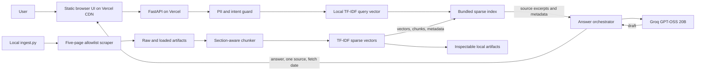

# Architecture — HDFC Mutual Fund FAQ Assistant

## 1. Purpose and deployment

This document describes the deployed prototype architecture. The public application is a Vercel-hosted FastAPI endpoint and static browser UI. The ingestion script runs manually from a trusted local machine and generates a read-only vector index bundled with the application.

- **Initial corpus:** Five explicitly allowlisted Groww pages; no link crawling.
- **Runtime:** Vercel Python Functions (FastAPI) and static CDN assets.
- **Vector store:** a bundled sparse TF-IDF index; no hosted database is required.
- **Embedding model:** the same locally generated TF-IDF vocabulary and inverse-document-frequency weights for ingestion and retrieval.

## 2. Architectural principles

1. **Allowlisted sources only:** ingestion requests the five configured URLs directly and never follows discovered links or redirects.
2. **Evidence before generation:** the LLM receives retrieved excerpts, not unrestricted web content.
3. **Citations are application-owned:** the application chooses the source URL and fetch date from retrieved metadata.
4. **Fail closed:** unsupported, low-confidence, unsafe, or untraceable questions receive a concise refusal.
5. **Explicit pipeline artifacts:** ingestion writes inspectable raw, loaded, chunk, embedding, and index manifests under ignored `data/`.
6. **Same vectorization end to end:** ingestion and query retrieval use the same TF-IDF vocabulary and IDF weights.
7. **No app-side query history:** questions and answers are not written to the corpus or local artifacts. API keys stay in environment secrets.

## 3. System context



### Trust boundaries

- **Browser to API:** input is untrusted and checked before any embedding or LLM call.
- **Ingestion to public sites:** only exact configured source URLs are fetched; redirects are rejected.
- **API to Groq:** only safe questions and retrieved excerpts are sent to Groq.
- **Bundled index:** corpus vectors and metadata are deployed with the Python application. Requests do not connect to a vector database or download an embedding model.
- **Local ingestion machine:** contains temporary public-source artifacts, not saved Q&A history or API keys in the repository.

## 4. Components

### 4.1 Browser UI

`public/index.html` is the static, responsive FAQ experience served by Vercel. Its visual direction adapts the `growfolio_dolce_vita_edition` Stitch export supplied in `stitch_growfolio.zip`: white stationery-like surfaces, pale-blue cabana stripes, butter-yellow accents, Bodoni Moda display type, readable Epilogue controls, and restrained botanical/postal motifs. The generated mock answer and mock metrics are not used; corpus counts and answers reflect the configured source set and live API response.

The page provides:

- A prominent question form, fixed Groq GPT-OSS 20B label, and example-question chips that only fill the question field.
- Corpus summaries for five approved pages, four scheme pages, and five pipeline steps.
- A directory of the five allowlisted public source pages and a visual load/chunk/embed/index/retrieve flow.
- A response card that renders the API answer as text and displays exactly the API-provided source URL and fetch date.
- Facts-only and privacy notices, responsive layouts, visible keyboard focus, and reduced-motion support.

The browser sends the question and the fixed `groq` provider to `POST /api/answer`; it does not persist question history or receive provider credentials. Network and API errors are shown in the response card rather than replaced with a sample answer.

### 4.2 FastAPI application

`app.py` exports the top-level FastAPI `app` expected by Vercel’s Python runtime. It validates request length and accepts only the Groq answer provider, runs guardrails, creates a sparse query vector from the bundled TF-IDF vocabulary, searches the bundled index using cosine similarity, calls Groq, validates the answer, and returns a small JSON response. `/api/health` is a basic health endpoint. Retrieval requires no database connection or model download.

TF-IDF is lexical rather than neural semantic search: exact scheme and fact terms are prioritized, but paraphrases may be less reliable. The legacy Streamlit prototype retains its separate configured local embedding model.

### 4.3 Ingestion pipeline

`ingest.py` is run manually from a trusted local machine. It uses only Python's standard library for TF-IDF vectorization; no database or embedding-provider key is needed.

| Phase | Component | Output |
|---|---|---|
| 1. Scrape | Fixed allowlist fetcher and HTML extractor | `data/pipeline/01_raw/pages.json` |
| 2. Load | Required-source, metadata, hash, and date validation | `data/pipeline/01_raw/loaded_documents.json`, `load_manifest.json` |
| 3. Chunk | Section-aware chunker | `data/pipeline/02_chunks/chunks.json` |
| 4. Embed | TF-IDF vocabulary and sparse vectors | `data/pipeline/03_embeddings/embeddings.json` |
| 5. Index | Bundled sparse vector index | `deployment_index.py` and `data/pipeline/04_vector_index/manifest.json` |

The script rejects failed responses, redirects, non-HTML pages, oversized responses, invalid page records, and partial source sets. It writes inspectable stage artifacts under `data/pipeline/` and atomically regenerates `deployment_index.py`. Commit the generated module when refreshing the corpus so Vercel deploys the updated index.

### 4.4 Bundled index and retrieval

The deployment bundle contains the TF-IDF vocabulary, IDF weights, sparse chunk vectors, text, and source metadata. At query time the application creates a normalized vector from that same vocabulary, computes cosine distance in memory, and applies an optional `source_id` filter. Retrieval validates source URLs, dates, weights, and result shape before generating an answer. The older Streamlit prototype retains a separate local ChromaDB index.

The configured distance threshold blocks LLM calls when evidence is weak. Only results from the selected citation URL are passed to the model.

### 4.5 Guardrails and answer orchestration

Before any external model call, the API:

1. Rejects likely PAN, Aadhaar, account number, OTP, email, and phone-number content.
2. Refuses recommendations, advice, and performance/return requests.
3. Declines statement-download questions because steps are absent from this five-page corpus.
4. Retrieves evidence for remaining factual questions.
5. Declines unsupported or low-confidence questions without calling the LLM.
6. Uses an LLM prompt that treats retrieved text as untrusted and limits the response to two short sentences.
7. Rejects URL-bearing, overlong, or performance-related generated text.
8. Adds exactly one source link and `Last updated from sources:` outside the model-generated text.

### 4.6 LLM provider adapter

Groq `openai/gpt-oss-20b` is the only answer model. Its model ID is in `config.yaml`; `GROQ_API_KEY` authenticates answer-generation requests. Groq Free plan availability and limits are organization-specific. Daily request exhaustion is distinguished from short-term request/token limits using Groq's rate-limit headers. TF-IDF vectorization runs locally without an external embedding API.

## 5. Configuration and secrets

Non-secret settings live in `config.yaml`: source allowlist, scraper limits, chunk size, retrieval `top_k` and distance threshold, Groq answer model, TF-IDF provider/model, and bundled vector store.

Vercel environment variables:

- Required: `GROQ_API_KEY`.

Use Vercel’s secret environment variable type; do not use a `NEXT_PUBLIC_` prefix. `.env` is ignored and must never be committed. `.env.example` contains names only.

## 6. Data contracts

### Chunk record

```json
{
  "id": "hdfc_large_cap-0001",
  "text": "Expense ratio ...",
  "metadata": {
    "source_id": "hdfc_large_cap",
    "source_title": "HDFC Large Cap Fund Direct Growth",
    "source_url": "https://groww.in/mutual-funds/hdfc-large-cap-fund-direct-growth",
    "section": "Scheme facts",
    "fetched_at": "YYYY-MM-DD"
  }
}
```

Each bundled index item contains the chunk text, normalized sparse vector, and source metadata. The answer date comes from the cited retrieval result, not the current date or the LLM.

### API response

```json
{
  "answer": "Factual response or safe refusal.",
  "source_url": "https://groww.in/mutual-funds/...",
  "last_updated": "YYYY-MM-DD"
}
```

## 7. Failures and operations

- Missing Groq configuration and invalid bundled indexes return clear errors rather than fabricated answers.
- Refreshes should be run from a trusted machine; verify the generated count and sample retrieval, then commit `deployment_index.py`.
- Do not expose a public endpoint without Vercel Firewall rate limits or equivalent controls; requests consume Vercel compute and Groq usage.
- Review source freshness, privacy, provider terms, and deployment logs before sharing the app publicly.

## 8. Known limits

- The corpus is limited to five Groww pages and does not provide statement-download instructions.
- The requested 15–25 URL bibliography conflicts with the exact five-page fetch limit.
- Groww pages may be stale or incomplete; AMC/SEBI/AMFI institutional sources are not indexed.
- The reference link used for performance refusals is not part of the indexed corpus.
- This prototype is not a production financial-support service.
