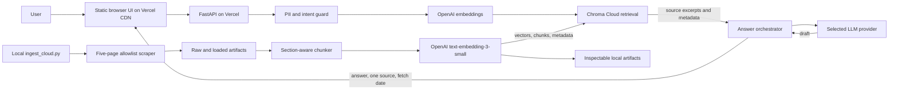

# Architecture — HDFC Mutual Fund FAQ Assistant

## 1. Purpose and deployment

This document describes the deployed prototype architecture. The public application is a Vercel-hosted FastAPI endpoint and static browser UI. The ingestion script runs manually from a trusted local machine and writes to Chroma Cloud.

- **Initial corpus:** Five explicitly allowlisted Groww pages; no link crawling.
- **Runtime:** Vercel Python Functions (FastAPI) and static CDN assets.
- **Vector store:** Chroma Cloud.
**Embedding model:** OpenAI `text-embedding-3-small` for both ingestion and retrieval.

## 2. Architectural principles

1. **Allowlisted sources only:** ingestion requests the five configured URLs directly and never follows discovered links or redirects.
2. **Evidence before generation:** the LLM receives retrieved excerpts, not unrestricted web content.
3. **Citations are application-owned:** the application chooses the source URL and fetch date from retrieved metadata.
4. **Fail closed:** unsupported, low-confidence, unsafe, or untraceable questions receive a concise refusal.
5. **Explicit pipeline artifacts:** ingestion writes inspectable raw, loaded, chunk, embedding, and index manifests under ignored `data/`.
6. **Same embedding model end to end:** ingestion and query-time embeddings use the configured OpenAI model.
7. **No app-side query history:** questions and answers are not written to the corpus or local artifacts. API keys stay in environment secrets.

## 3. System context



### Trust boundaries

- **Browser to API:** input is untrusted and checked before any embedding or LLM call.
- **Ingestion to public sites:** only exact configured source URLs are fetched; redirects are rejected.
- **API to providers:** only safe questions and retrieved excerpts are sent to the configured provider APIs.
- **Vercel to Chroma Cloud:** the vector database is external and durable; credentials are server-side environment secrets.
- **Local ingestion machine:** contains temporary public-source artifacts, not saved Q&A history or API keys in the repository.

## 4. Components

### 4.1 Browser UI

`public/index.html` is the static, responsive FAQ experience served by Vercel. Its visual direction adapts the `growfolio_dolce_vita_edition` Stitch export supplied in `stitch_growfolio.zip`: white stationery-like surfaces, pale-blue cabana stripes, butter-yellow accents, Bodoni Moda display type, readable Epilogue controls, and restrained botanical/postal motifs. The generated mock answer and mock metrics are not used; corpus counts and answers reflect the configured source set and live API response.

The page provides:

- A prominent question form, answer-model selector, and example-question chips that only fill the question field.
- Corpus summaries for five approved pages, four scheme pages, and five pipeline steps.
- A directory of the five allowlisted public source pages and a visual load/chunk/embed/store/retrieve flow.
- A response card that renders the API answer as text and displays exactly the API-provided source URL and fetch date.
- Facts-only and privacy notices, responsive layouts, visible keyboard focus, and reduced-motion support.

The browser sends only the question and selected answer provider to `POST /api/answer`; it does not persist question history or receive provider credentials. Network and API errors are shown in the response card rather than replaced with a sample answer.

### 4.2 FastAPI application

`app.py` exports the top-level FastAPI `app` expected by Vercel’s Python runtime. It validates request length and provider selection, runs guardrails, creates query embeddings, searches Chroma Cloud, calls the selected LLM, validates the answer, and returns a small JSON response. `/api/health` is a basic health endpoint.

The app does not load or embed the local Sentence Transformers model. This keeps local ML model weights out of the serverless function bundle.

### 4.3 Ingestion pipeline

`ingest_cloud.py` is run manually from a trusted local machine after setting OpenAI and Chroma Cloud credentials in local environment variables or `.env`.

| Phase | Component | Output |
|---|---|---|
| 1. Scrape | Fixed allowlist fetcher and HTML extractor | `data/01_raw/pages.json` |
| 2. Load | Required-source, metadata, hash, and date validation | `loaded_documents.json`, `load_manifest.json` |
| 3. Chunk | Section-aware chunker | `data/02_chunks/chunks.json` |
| 4. Embed | OpenAI `text-embedding-3-small` | `data/03_embeddings/embeddings.json` |
| 5. Index | Chroma Cloud client | Cloud collection and `data/04_vector_db/manifest.json` |

The script rejects failed responses, redirects, non-HTML pages, oversized responses, invalid page records, and partial source sets. It writes stage artifacts locally and verifies the stored count and a sample retrieval after indexing. Re-running upserts stable chunk IDs and removes stale IDs.

### 4.4 Vector database and retrieval

Chroma Cloud stores chunk text, supplied embedding vectors, and source metadata. Vercel queries the named collection using `query_embeddings` generated with the same configured OpenAI model used by ingestion. Scheme mentions add a `source_id` metadata filter. Retrieval validates source URLs, dates, distances, and result shape before generating an answer.

The configured distance threshold blocks LLM calls when evidence is weak. Only results from the selected citation URL are passed to the model.

### 4.5 Guardrails and answer orchestration

Before any external model call, the API:

1. Rejects likely PAN, Aadhaar, account number, OTP, email, and phone-number content.
2. Refuses recommendations, advice, and performance/return requests.
3. Declines statement-download questions because steps are absent from this five-page corpus.
4. Retrieves evidence for remaining factual questions.
5. Declines unsupported or low-confidence questions without calling the LLM.
6. Uses an LLM prompt that treats retrieved text as untrusted and limits the response to two short sentences.
7. Rejects URL-bearing, overlong, or performance-related generated text.
8. Adds exactly one source link and `Last updated from sources:` outside the model-generated text.

### 4.6 LLM provider adapter

The default provider is OpenAI. Gemini, Anthropic, and Mistral are selectable alternatives in the UI when their API keys are configured. OpenAI is still required for embeddings, regardless of the selected answer-generation provider.

## 5. Configuration and secrets

Non-secret settings live in `config.yaml`: source allowlist, scraper limits, chunk size, retrieval `top_k` and distance threshold, provider models, OpenAI embedding model, and Chroma Cloud collection name.

Vercel environment variables:

- Required: `OPENAI_API_KEY`, `CHROMA_API_KEY`, `CHROMA_TENANT`, `CHROMA_DATABASE`.
- Optional: `CHROMA_HOST` for a non-default Chroma Cloud region.
- Optional answer providers: `GEMINI_API_KEY`, `ANTHROPIC_API_KEY`, `MISTRAL_API_KEY`.

Use Vercel’s secret environment variable type; do not use a `NEXT_PUBLIC_` prefix. `.env` is ignored and must never be committed. `.env.example` contains names only.

## 6. Data contracts

### Chunk record

```json
{
  "id": "hdfc_large_cap-0001",
  "text": "Expense ratio ...",
  "metadata": {
    "source_id": "hdfc_large_cap",
    "source_title": "HDFC Large Cap Fund Direct Growth",
    "source_url": "https://groww.in/mutual-funds/hdfc-large-cap-fund-direct-growth",
    "section": "Scheme facts",
    "fetched_at": "YYYY-MM-DD"
  }
}
```

The same metadata is stored with each Chroma Cloud record. The answer date comes from the cited retrieval result, not the current date or the LLM.

### API response

```json
{
  "answer": "Factual response or safe refusal.",
  "source_url": "https://groww.in/mutual-funds/...",
  "last_updated": "YYYY-MM-DD"
}
```

## 7. Failures and operations

- Missing environment variables return a configuration error; provider or database failures are surfaced rather than converted to fabricated answers.
- Empty Chroma Cloud collections return a clear message to run `ingest_cloud.py`.
- Refreshes should be run from a trusted machine; verify the generated count and sample retrieval.
- Do not expose a public endpoint without Vercel Firewall rate limits or equivalent controls; requests can incur embedding and LLM costs.
- Review source freshness, privacy, provider terms, and deployment logs before sharing the app publicly.

## 8. Known limits

- The corpus is limited to five Groww pages and does not provide statement-download instructions.
- The requested 15–25 URL bibliography conflicts with the exact five-page fetch limit.
- Groww pages may be stale or incomplete; AMC/SEBI/AMFI institutional sources are not indexed.
- The reference link used for performance refusals is not part of the indexed corpus.
- This prototype is not a production financial-support service.
