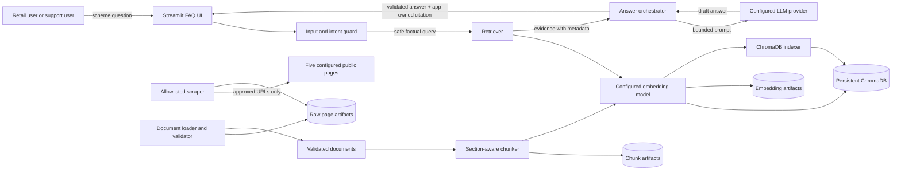

# Architecture — HDFC Mutual Fund FAQ Assistant

## 1. Purpose and status

This document describes the target architecture for the prototype defined in [PRD.md](./PRD.md). It focuses on the local, phased RAG workflow, source traceability, privacy controls, and configuration boundaries.

**Status:** Draft  
**Primary deployment:** Local Streamlit application  
**Initial corpus:** Five explicitly allowlisted Groww pages; no link crawling

## 2. Architectural principles

1. **Allowlisted sources only:** the scraper requests configured URLs directly and never follows discovered links.
2. **Evidence before generation:** the LLM receives retrieved excerpts, not unrestricted web content.
3. **Citations are application-owned:** the application derives the one source link and fetch date from retrieved metadata; the LLM cannot choose or invent citations.
4. **Fail closed:** unsupported, low-confidence, unsafe, or untraceable questions receive a concise refusal instead of a guessed fact.
5. **Explicit pipeline artifacts:** every ingestion phase writes an inspectable output.
6. **Same embedding configuration end to end:** ingestion and query-time embeddings use the same provider and model.
7. **No user-query persistence:** questions, answers, sensitive values, and API keys are not written to application storage or logs.

## 3. System context



### Trust boundaries

- **Browser to app:** user input is treated as untrusted and checked before any embedding or LLM call.
- **App to public sources:** ingestion can contact only the five configured URLs.
- **App to model provider:** only a safe question and selected corpus excerpts are sent. Provider keys come from local environment configuration.
- **Local disk:** stores public source artifacts and the vector database, but not user question/answer history or API keys.

## 4. Component architecture

### 4.1 UI

The Streamlit UI presents a welcome message, three example questions, the facts-only disclaimer, a question field, and a response area. A pipeline panel exposes ingestion progress and non-sensitive artifact counts. A demo/debug view may show retrieved corpus passages and metadata, but never user history or secrets.

### 4.2 Input and intent guard

Runs before query embedding or model invocation:

1. Reject likely PAN, Aadhaar, account number, OTP, email, and phone-number content.
2. Classify advice/portfolio-selection requests and return a polite refusal.
3. Classify performance/return requests and refuse performance claims while linking to an approved official factsheet/disclosure source.
4. Route only supported factual questions to retrieval.

Rejected input is not persisted, embedded, or sent to an LLM.

### 4.3 Ingestion pipeline

The pipeline is invoked explicitly by the user and processes each configured source independently. It does not crawl anchors, follow redirects to other content, or add URLs discovered in page text to the source set.

| Phase | Component | Output |
|---|---|---|
| 1. Scrape | Allowlisted HTTP fetcher and HTML text extractor | `data/01_raw/pages.json` |
| 2. Load | Raw-document reader, schema/allowlist validator | `data/01_raw/loaded_documents.json` and `load_manifest.json` |
| 3. Chunk | Section-aware chunker | `data/02_chunks/chunks.json` |
| 4. Embed | Sentence Transformers adapter | `data/03_embeddings/embeddings.json` |
| 5. Index | ChromaDB adapter | `data/04_vector_db/chroma/` and `manifest.json` |

#### Chunking strategy

- Preserve facts as compact, section-aware units so labels and values remain together.
- Use a target maximum chunk size and split only at sensible text/section boundaries.
- Attach source and scheme metadata to every chunk.
- Exclude performance, returns, and ranking material from the answerable index.
- Do not merge unrelated schemes into a single chunk.

#### Ingestion manifest

The manifest records run ID, completion time, per-source fetch status/date, chunk count, embedding provider/model, vector-store provider/collection, and artifact paths. Failed fetches must be explicit. A failed or partial run must not be presented as a completed refresh.

### 4.4 Embedding adapter

The initial adapter uses `sentence-transformers/all-MiniLM-L6-v2`. The adapter is invoked for both document and query embeddings. The configured model identity is stored in the ingestion manifest and checked before querying the collection; a mismatch requires re-ingestion rather than silently mixing vector spaces.

### 4.5 Vector-store adapter

ChromaDB is the initial configured vector database. Its persistence directory and collection name are configuration values. Each record stores:

- Stable chunk ID.
- Chunk text.
- Embedding vector.
- Scheme/source identifier.
- Source title and URL.
- Section heading.
- Source fetch date.

The adapter exposes narrow operations for replacing/upserting a completed corpus generation and querying top-k relevant chunks. The UI and answer layer do not depend on ChromaDB-specific objects.

### 4.6 Retrieval and answer orchestration

For an allowed factual question:

1. Resolve an explicit scheme mention to a scheme filter when possible.
2. Embed the question with the configured document embedding model.
3. Query the configured ChromaDB collection for top-k chunks.
4. Apply a maximum-distance threshold (lower distance indicates a closer match); if no evidence passes, return an unsupported response.
5. Build a bounded prompt containing only the question, retrieved excerpts, their sections, and source identifiers.
6. Call the configured LLM provider.
7. Validate answer length and policy; reject unsupported claims or an invalid response.
8. Select one citation URL and fetch date from the best supporting result and render them outside the model-generated text.

The model must not generate URLs. The application adds exactly one citation link and the required “Last updated from sources: YYYY-MM-DD” line to every answer or refusal.

### 4.7 LLM provider adapter

An application-level interface isolates provider differences:

```text
generate(system_instructions, question, evidence) -> answer_text
```

The initial provider is Groq using the requested model identifier `qwen/qwen3.8-27b`. Gemini, OpenAI, Anthropic, and Mistral are selectable alternatives. Provider endpoint, model, timeout, and key-variable name are configuration; model/API errors are surfaced to the user. The requested Groq model identifier must be verified with the provider before release.

## 5. Configuration

Non-secret configuration is centralized in a YAML or TOML file. Example shape:

```yaml
sources:
  - id: hdfc_amc
    url: https://groww.in/mutual-funds/amc/hdfc-mutual-funds
embedding:
  provider: sentence-transformers
  model: sentence-transformers/all-MiniLM-L6-v2
vector_db:
  provider: chromadb
  persist_directory: data/04_vector_db/chroma
  collection_name: hdfc_mutual_fund_faq
retrieval:
  top_k: 4
  max_distance: 0.9
llm:
  default_provider: groq
  providers:
    groq:
      model_env: GROQ_MODEL
      api_key_env: GROQ_API_KEY
```

Local environment configuration contains secrets and the selected model value, for example:

```dotenv
GROQ_API_KEY=<local secret>
GROQ_MODEL=qwen/qwen3.8-27b
```

The `.env` file must be excluded from source control and all generated artifacts. A checked-in `.env.example` may contain variable names and empty values only.

## 6. Data contracts

### Raw page record

```json
{
  "source_id": "hdfc_large_cap",
  "title": "HDFC Large Cap Fund Direct Growth",
  "url": "https://groww.in/mutual-funds/hdfc-large-cap-fund-direct-growth",
  "fetched_at": "YYYY-MM-DD",
  "text": "..."
}
```

### Chunk record

```json
{
  "id": "hdfc_large_cap-0001",
  "text": "Expense ratio ...",
  "metadata": {
    "source_id": "hdfc_large_cap",
    "scheme": "HDFC Large Cap Fund Direct Growth",
    "source_url": "https://groww.in/mutual-funds/hdfc-large-cap-fund-direct-growth",
    "section": "Scheme facts",
    "fetched_at": "YYYY-MM-DD"
  }
}
```

Fetched dates belong to the source record and are copied into chunks. The response date must come from the cited result, not the current date or the LLM.

## 7. Request and response flows

### Supported factual question

```text
User → UI → PII/policy guard → query embedding → ChromaDB top-k
     → evidence threshold → provider adapter → answer validation
     → application citation/date → UI
```

### Unsafe or unsupported question

```text
User → UI → guard or retrieval threshold → safe refusal
     → approved educational/source link + source date → UI
```

No unsafe or unsupported question is sent to the LLM. If an educational link has not been approved and indexed/referenced, the assistant must use a relevant source link from the allowed set or clearly state the limitation.

## 8. Failure handling and consistency

- **Fetch failure:** record source-level error; do not mark the refresh complete.
- **Chunk/embed/index failure:** show the failed phase and preserve the last known-good collection.
- **Embedding model mismatch:** block retrieval and require re-ingestion.
- **Empty or weak retrieval:** return “not found in the indexed sources” with a relevant source citation; do not invoke the LLM.
- **Provider/API failure:** show a clear error; never convert it into a success-shaped factual answer.
- **Missing citation metadata:** do not return a factual answer.
- **Overlong or policy-violating model output:** reject it or use a deterministic safe fallback; do not silently present it as verified.

For a robust refresh, build a new corpus generation and switch the active collection/manifest only after all phases succeed.

## 9. Security and privacy

- Do not persist user questions, answers, PII, prompts, or API keys.
- Run PII checks before embeddings and external model calls.
- Keep provider credentials in environment variables; never show them in the UI or debug output.
- Do not expose a public endpoint without a separate privacy, rate-limit, and deployment review.
- Treat retrieved web text as untrusted data; system instructions and application policy take precedence over source text.
- Restrict network fetching to the static source allowlist.

## 10. Deployment and operations

The prototype runs locally through Streamlit. Python dependencies include the UI framework, HTML parser, HTTP client, ChromaDB, YAML/configuration support, and Sentence Transformers. The first embedding run may download model weights. Store generated artifacts locally and keep secrets outside the repository. A hosted deployment or demo video is a separate handoff decision.

## 11. Architecture decisions and open questions

1. Confirm whether the five specified Groww pages are sufficient as sources, or approve official AMC/SEBI/AMFI pages for citation and statement guidance.
2. Resolve how to meet the 15–25 URL bibliography request while fetching only five pages.
3. Approve an official educational link for advice refusals and an official factsheet/disclosure link for performance refusals.
4. Verify that Groq currently supports `qwen/qwen3.8-27b`.
5. Set the retrieval distance threshold using representative queries and negative/unsupported questions.
6. Decide whether local `.env` loading is required or whether environment variables supplied by the shell are sufficient.
